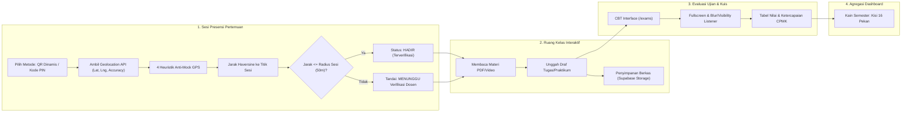
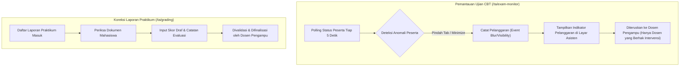
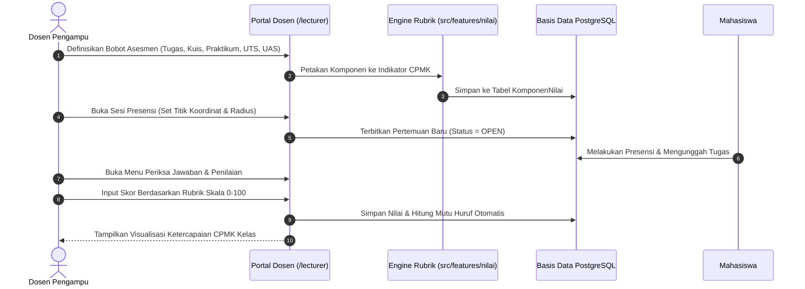
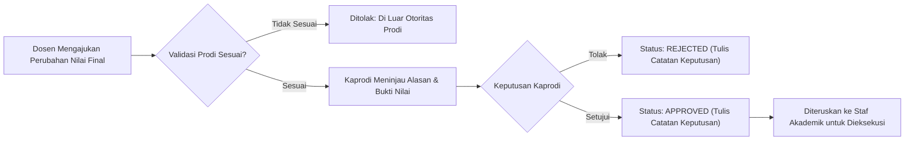
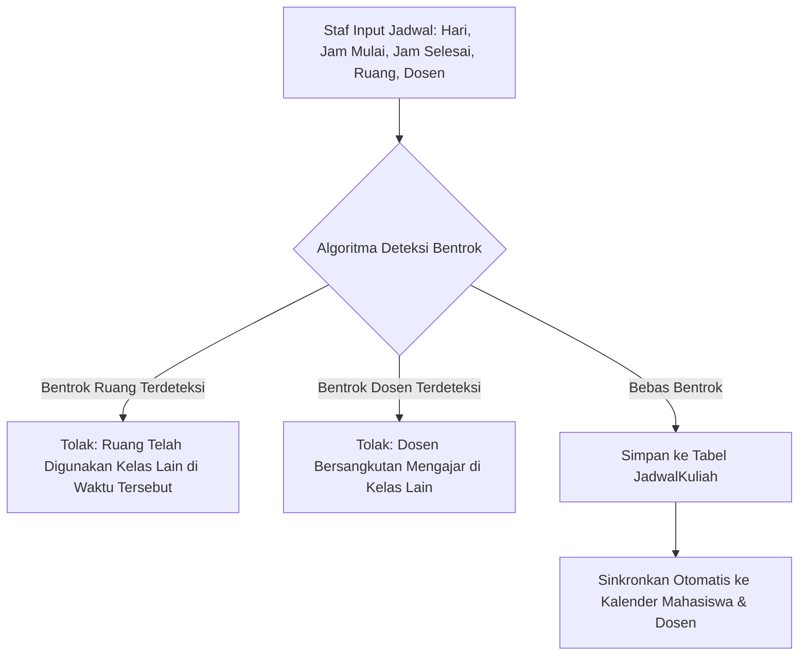
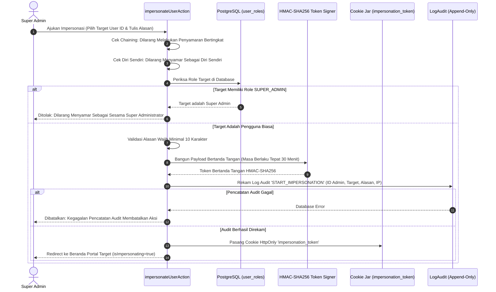
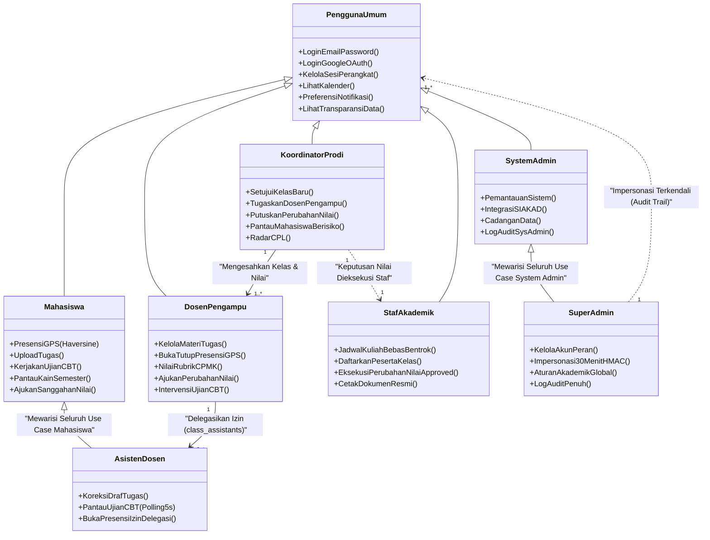

# Dokumentasi Arsitektur Lengkap per Peran (Aktor)
**RuangKampus — Sistem Pembelajaran & Manajemen Akademik Berbasis OBE**  
**Program Studi Teknik Informatika · Universitas Islam Riau**  
*Dituntun langsung dari implementasi kode sumber repositori (branch `main` & `fitur/kain-semester`)*

---

## 1. Arsitektur Peran Mahasiswa (`STUDENT`)

### A. Filosofi & Batasan Peran
Peran Mahasiswa dirancang sebagai **ruang kendali belajar terpadu (*academic cockpit*)**. Mahasiswa memiliki akses baca ke seluruh materi dan kurikulum yang diambil pada semester aktif, hak mengumpulkan tugas, verifikasi presensi mandiri, serta pengerjaan ujian CBT. Mahasiswa diisolasi secara ketat oleh *Row-Level Security* (RLS) dan filter kueri Prisma sehingga tidak dapat mengakses berkas, nilai, atau draf ujian mahasiswa lain.

### B. Hierarki Navigasi & Rute Portal
- **Gerbang Utama**: `/student`
- **Grup Menu (16 Item)**:
  1. **Utama**: Beranda (`/student`), Kalender (`/calendar`), Notifikasi (`/notifications`), Pengumuman (`/announcements`)
  2. **Belajar**: Kelas Saya (`/classes`), Ujian (`/exams`), Perpustakaan Digital (`/library`), Tanya AI (`/ai-assistant`), Pesan Kuliah (`/messages`), Flashcard Materi (`/flashcards`), Tukar Keahlian (`/skill-exchange`)
  3. **Nilai**: Nilai Saya & Transkrip (`/grades`), Pencapaian / Badge OBE (`/achievements`), Sertifikat Kompetensi (`/certificates`)
  4. **Lainnya**: Komunitas Mahasiswa (`/community`), Evaluasi Kinerja Dosen (`/evaluations`), Pengajuan Surat & Legalisasi (`/requests`)

### C. Alur Data & Siklus Belajar Mahasiswa

### D. Fitur Teknis Kunci Mahasiswa
1. **Mesin Kisi 'Kain Semester'**:
   - Menghitung status 16 kolom pekan untuk setiap mata kuliah yang tercantum pada tabel `KRSDetail`.
   - Simbol sel: `■` (Presensi Lengkap + Tugas Terkumpul), `◧` (Presensi Lengkap, tugas belum masuk), `○` (Alpa / Terlewat), `[ ]` (Pekan berjalan).
2. **Sistem Peringatan Dini (*Early Warning System*)**:
   - Algoritma pemicu: Jika ketidakhadiran mencapai $\ge 3$ kali atau persentase kehadiran $< 75\%$, sistem memunculkan peringatan kritis dan mengirimkan notifikasi ke Dosen Wali.
3. **Presensi Multi-Faktor**:
   - Validasi QR dinamis dengan toleransi kedaluwarsa 10 detik (*grace period*) atau kode PIN 6-digit.
   - Evaluasi integritas geospasial: deteksi akurasi $< 1\text{m}$ atau $> 500\text{m}$, lompatan kecepatan tidak wajar (*speed jump*), koordinat identik 6 desimal antar mahasiswa, dan ketidaksesuaian IP. Bila berada di luar radius, presensi tidak ditolak mentah-mentah melainkan ditandai untuk diverifikasi dosen.

---

## 2. Arsitektur Peran Asisten Dosen (`TEACHING_ASSISTANT`)

### A. Filosofi & Batasan Peran
Peran Asisten Dosen adalah **peran hibrida terdelegasi (*Delegated Hybrid Role*)**. Pengguna adalah mahasiswa aktif yang mendapatkan delegasi operasional per kelas dari Dosen Pengampu melalui tabel `class_assistants`. Batasan tegas di kode: Asisten **tidak dapat memfinalisasi nilai akhir, tidak dapat mengajukan perubahan nilai final, tidak dapat menugaskan staf, dan tidak dapat mengintervensi peserta ujian secara langsung**.

### B. Hierarki Navigasi & Rute Portal
- **Gerbang Utama**: `/ta`
- **Grup Menu (19 Item)**:
  1. **Utama**: Beranda Asisten (`/ta`), Kalender, Notifikasi, Pengumuman
  2. **Asistensi Khusus (3 Item)**: Kelas Asistensi (`/ta/classes`), Koreksi Draf Tugas (`/ta/grading`), Pantau Ujian CBT (`/ta/exam-monitor`)
  3. **Belajar, Nilai, Lainnya**: Mewarisi seluruh use case mahasiswa aktif

### C. Alur Kerja Pengawasan Ujian & Koreksi Praktikum

### D. Fitur Teknis Kunci Asisten Dosen
1. **Pemeriksaan Izin Delegasi Berbasis Database**:
   - Lima izin delegasi: `can_review_submissions`, `can_grade_draft`, `can_manage_materials`, `can_manage_announcements`, dan `can_open_attendance`.
   - Aksi seperti `createAttendanceSessionAction` memeriksa apakah kolom `can_open_attendance` bernilai `true` sebelum sesi dibuka.

---

## 3. Arsitektur Peran Dosen Pengampu (`LECTURER`)

### A. Filosofi & Batasan Peran
Dosen bertindak sebagai **manajer instruksional dan evaluator luaran pembelajaran (*Instructional Manager & OBE Assessor*)**. Dosen memiliki hak penuh atas pengelolaan konten pembelajaran, penyelenggaraan sesi presensi, penyusunan instrumen rubrik penilaian, intervensi peserta ujian, dan pembimbingan akademik (wali).

### B. Hierarki Navigasi & Rute Portal
- **Gerbang Utama**: `/lecturer`
- **Grup Menu (19 Item)**:
  1. **Utama**: Beranda Dosen (`/lecturer`), Kalender, Notifikasi, Pengumuman
  2. **Mengajar**: Kelas Saya (`/classes`), Berita Acara Perkuliahan (`/lecturer/journals`), Tinjau Konten Buatan AI (`/lecturer/content-review`), Perpustakaan (`/library`)
  3. **Ujian dan Nilai**: Ujian dan Kuis (`/exams`), Bank Soal Mandiri (`/exams/question-bank`), Periksa Jawaban Esai (`/exams/review`), Analisis Butir Soal (`/exams/analysis`), Rubrik CPMK (`/lecturer/rubrics`), Buku Nilai Komprehensif (`/analytics`), Tanggapan Sanggahan Nilai (`/lecturer/disputes`)
  4. **Lainnya**: Pesan Mahasiswa (`/messages`), Mahasiswa Bimbingan Akademik (`/lecturer/mentoring`), Hasil Evaluasi Dosen (`/lecturer/evaluations`), Komunitas Riset (`/community`)

### C. Alur Kerja Evaluasi OBE Dosen

### D. Fitur Teknis Kunci Dosen
1. **Pengendalian Sesi Presensi**:
   - Dosen menyimpan koordinat sesi; jika tidak diisi, sistem menggunakan koordinat cadangan dengan radius bawaan 50 meter.
   - Dosen dapat menyetujui sekaligus (*bulk approve*) presensi yang berstatus menunggu verifikasi di luar radius.
2. **Koreksi Esai dengan Bantuan AI & Cek Kemiripan**:
   - Dilengkapi integrasi Gemini API untuk evaluasi draf jawaban esai serta mesin deteksi kemiripan penugasan (*similarity check*).
3. **Pengajuan Perubahan Nilai Final**:
   - Jika buku nilai telah dikunci, dosen mengajukan perubahan nilai final yang wajib diputuskan oleh Koordinator Program Studi.

---

## 4. Arsitektur Peran Koordinator Program Studi (`PROGRAM_COORDINATOR`)

### A. Filosofi & Batasan Peran
Kaprodi bertindak sebagai **penjamin mutu kurikulum dan pengawas capaian lulusan (*Curriculum Quality & CPL Assurance*)**. Kaprodi memiliki wewenang khusus untuk menyetujui kelas yang diajukan, menugaskan dosen pengampu, memutuskan permohonan perubahan nilai final, serta memantau mahasiswa berisiko putus studi (*at-risk*). **Aksi persetujuan kelas dan penugasan dosen diblokir secara ketat saat sesi impersonasi aktif.**

### B. Hierarki Navigasi & Rute Portal
- **Gerbang Utama**: `/coordinator`
- **Grup Menu (12 Item)**:
  1. **Utama**: Beranda Kaprodi (`/coordinator`), Kalender, Notifikasi, Pengumuman
  2. **Prodi**: Manajemen Kurikulum & CPL (`/coordinator/curriculum`), Direktori Mata Kuliah (`/coordinator/courses`), Penugasan Dosen Pengampu (`/coordinator/assignments`), Evaluasi Kinerja Dosen (`/coordinator/evaluations`)
  3. **Pantauan**: Monitoring Perkuliahan Real-Time (`/coordinator/monitoring`), Analisis Mahasiswa Berisiko per Angkatan (`/coordinator/monitoring/at-risk`)
  4. **Persetujuan**: Persetujuan Perubahan Nilai (`/coordinator/approvals`), Laporan Kinerja Akademik Prodi (`/coordinator/reports`)

### C. Alur Persetujuan Perubahan Nilai Kaprodi

---

## 5. Arsitektur Peran Staf Administrasi Akademik (`ACADEMIC_STAFF`)

### A. Filosofi & Batasan Peran
Staf Akademik bertindak sebagai **pengendali data operasional dan eksekutor dokumen resmi (*Academic Registrar & Logistics*)**. Staf bertanggung jawab atas penyusunan jadwal kuliah bebas bentrok, pendaftaran dan pemindahan peserta kelas, eksekusi perubahan nilai yang telah disetujui Kaprodi, serta pengelolaan berkas akademik.

### B. Hierarki Navigasi & Rute Portal
- **Gerbang Utama**: `/staff`
- **Grup Menu (13 Item)**:
  1. **Utama**: Beranda Staf (`/staff`), Kalender Akademik, Notifikasi
  2. **Data Induk**: Master Mahasiswa (`/staff/master/students`), Master Dosen (`/staff/master/lecturers`), Data Akademik Prodi & Ruang (`/staff/master`)
  3. **Akademik**: Penyusunan Jadwal Bebas Bentrok (`/staff/schedules`), Kelas dan Peserta (`/staff/classes`), Audit Nilai dan Presensi (`/staff/grades`)
  4. **Layanan**: Verifikasi Pengajuan Mahasiswa (`/staff/services/verification`), Pengumuman dan Acara Kampus (`/staff/announcements`), Berkas dan Sertifikat (`/staff/content`), Moderasi Konten Komunitas (`/staff/moderation`)

### C. Alur Deteksi Bentrok Penjadwalan Staf

### D. Fitur Teknis Kunci Staf Akademik
1. **Eksekusi Perubahan Nilai**:
   - Staf memvalidasi status `APPROVED` dari Kaprodi dan mengeksekusi perubahan nilai ke tabel database utama secara idempoten (hanya diizinkan satu kali eksekusi per pengajuan).
2. **Pencetakan Berkas Resmi**:
   - Pembuatan dokumen cetak (KRS, KHS, Kartu Ujian) dengan kotak tanda tangan resmi tata letak.

---

## 6. Arsitektur Peran System Administrator (`SYSTEM_ADMIN`)

### A. Filosofi & Batasan Peran
System Admin bertanggung jawab atas **kesehatan operasional infrastruktur dan konektivitas sistem (*System Operations & Infrastructure Stability*)**. System Admin memantau metrik performa, mengelola cadangan data, dan memeriksa log audit operasional melalui *view* terfilter `audit_logs_for_sysadmin`.

### B. Hierarki Navigasi & Rute Portal
- **Gerbang Utama**: `/admin/system`
- **Grup Menu (8 Item)**:
  1. **Utama**: Beranda Sistem (`/admin/system`), Notifikasi
  2. **Server**: Pemantauan Sistem & Endpoint (`/admin/system/monitoring`), Integrasi Eksternal SIAKAD (`/admin/system/integrations`)
  3. **Keamanan**: Sesi Login & Manajemen Sesi (`/admin/system/security`), Cadangan & Pemulihan Data (`/admin/system/backup`)
  4. **Pengaturan**: Pengaturan Sistem (`/admin/system/settings`), Log Audit Operasional (`/admin/system/audit`)

---

## 7. Arsitektur Peran Super Administrator (`SUPER_ADMIN`)

### A. Filosofi & Batasan Peran
Super Admin memegang **kedaulatan tata kelola platform, keamanan identitas, dan audit forensik menyeluruh (*Platform Governance & Forensic Authority*)**. Memiliki hak mengelola akun dan peran pengguna, mengubah aturan akademik global, membaca log audit penuh, serta menjalankan impersonasi legal yang terikat aturan forensik ketat. Super Admin **mewarisi seluruh use case operasional milik System Admin**.

### B. Hierarki Navigasi & Rute Portal
- **Gerbang Utama**: `/admin`
- **Grup Menu (12 Item Utama + 8 Item Sub-Hub Sistem)**:
  1. **Utama**: Beranda Tata Kelola (`/admin`), Notifikasi
  2. **Pengguna**: Tata Kelola Akun Pengguna (`/admin/users`), Matriks Peran dan Hak Akses (`/admin/roles`)
  3. **Aturan Kampus**: Kebijakan Akademik & Batas Peringatan Dini (`/admin/policies`)
  4. **Sub-Hub Server**: Mengakses seluruh 8 menu System Admin di `/admin/system/*`

### C. Protokol Kriptografis Impersonasi Super Admin

### D. Fitur Teknis Kunci Super Admin
1. **Pencegahan Penghapusan Diri Sendiri & Super Admin Terakhir**:
   - Sistem menolak aksi penghapusan akun bila akun yang dihapus adalah akun admin yang sedang login atau merupakan satu-satunya Super Admin aktif di database.
2. **Log Audit Terkendali**:
   - Penyimpanan riwayat aksi berprinsip *append-only* dengan pengecualian terkontrol (`lawful_retention_purge`, `lawful_anonymization`).
3. **Blokir Aksi Sensitif Selama Impersonasi**:
   - Saat sesi impersonasi aktif, aksi persetujuan kelas, penugasan dosen, perubahan kata sandi, dan perubahan email diblokir secara mutlak di tingkat Server Action.

---

## 8. Diagram Relasi Pewarisan & Kolaborasi Antar Peran

