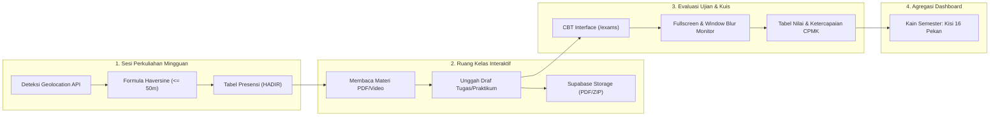
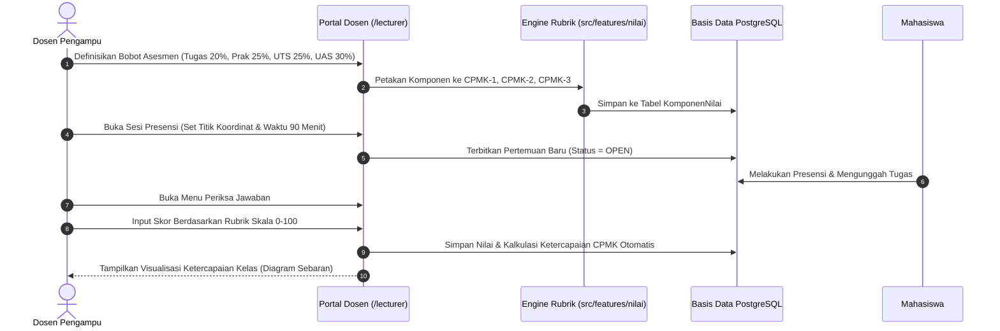
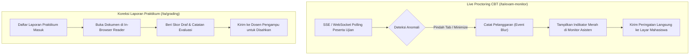
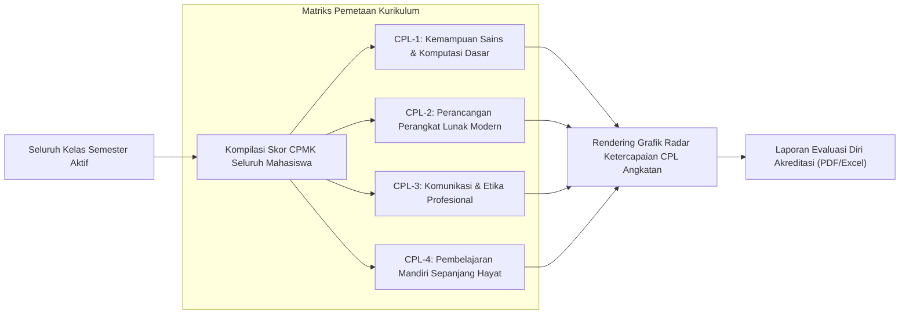
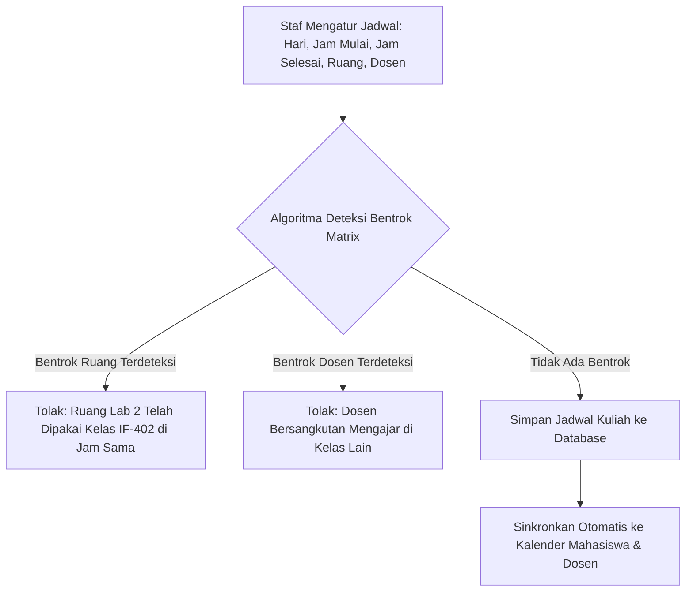
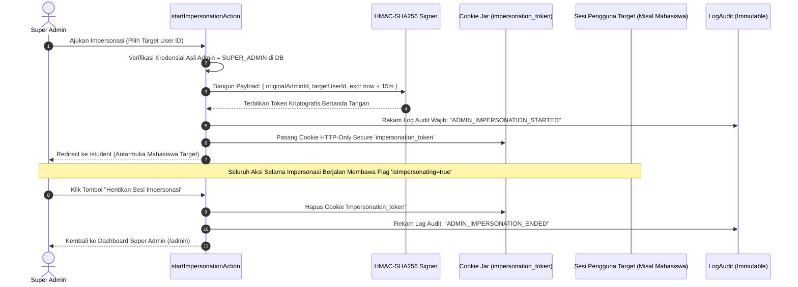
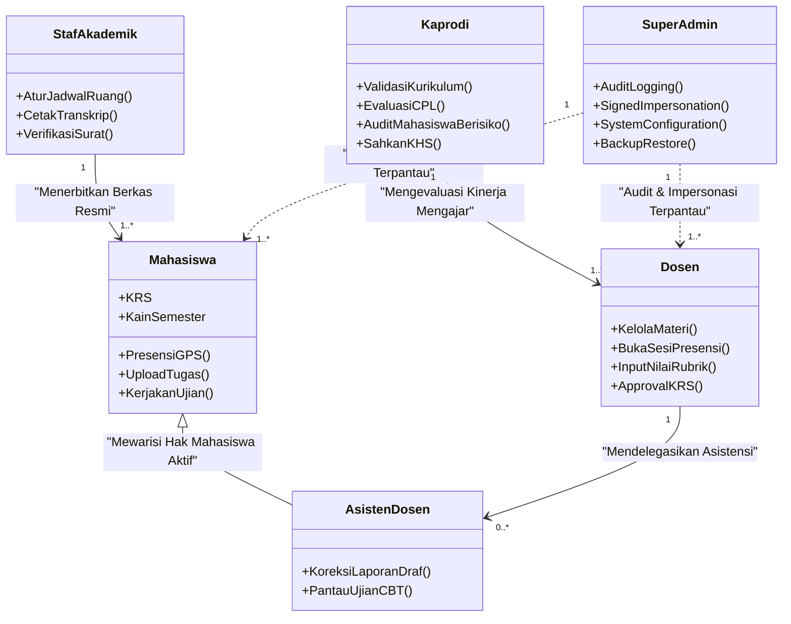

# Dokumentasi Arsitektur Super Lengkap per Peran (Aktor)
**RuangKampus — Sistem Pembelajaran & Manajemen Akademik Berbasis OBE**  
**Program Studi Teknik Informatika · Universitas Islam Riau**

---

## 1. Arsitektur Peran Mahasiswa (`STUDENT`)

### A. Filosofi & Batasan Peran
Peran Mahasiswa dirancang dengan prinsip **fokus belajar tanpa friksi administratif (*frictionless academic cockpit*)**. Mahasiswa memiliki akses baca ke seluruh materi dan kurikulum yang diambil, hak unggah tugas dan ujian, serta verifikasi presensi mandiri berbasis lokasi. Mahasiswa **diisolasi secara ketat** oleh RLS (*Row-Level Security*) dan kueri terfilter Prisma sehingga tidak dapat melihat data nilai, draf soal, atau berkas pribadi mahasiswa lain.

### B. Hierarki Navigasi & Rute Portal
- **Gerbang Utama**: `/student`
- **Grup Menu**:
  1. **Utama**: Beranda (`/student`), Kalender (`/calendar`), Notifikasi (`/notifications`), Pengumuman (`/announcements`)
  2. **Belajar**: Kelas Saya (`/classes`), Ujian (`/exams`), Perpustakaan Digital (`/library`), Tanya AI (`/ai-assistant`), Pesan Kuliah (`/messages`), Flashcard Materi (`/flashcards`), Tukar Keahlian (`/skill-exchange`)
  3. **Nilai**: Nilai Saya & Transkrip (`/grades`), Pencapaian / Badge OBE (`/achievements`), Sertifikat Kompetensi (`/certificates`)
  4. **Lainnya**: Komunitas Mahasiswa (`/community`), Evaluasi Kinerja Dosen (`/evaluations`), Pengajuan Surat & Legalisasi (`/requests`)

### C. Alur Data & Siklus Belajar Mahasiswa

### D. Fitur Teknis Kunci Mahasiswa
1. **Mesin Kisi 'Kain Semester'**:
   - Menghitung status 16 kolom pekan untuk setiap mata kuliah yang tercantum pada tabel `KRSDetail`.
   - Kode sel: `■` (Presensi Lengkap + Tugas Terkumpul), `◧` (Presensi Lengkap, tugas belum masuk), `○` (Alpa / Terlewat), `[ ]` (Pekan berjalan).
2. **Sistem Peringatan Dini (*Early Warning System*)**:
   - Algoritma pemicu: Jika ketidakhadiran mencapai $\ge 3$ kali atau persentase kehadiran $< 75\%$, sistem mengunci hak ujian secara otomatis dan mengirim peringatan ke Dosen Wali.

---

## 2. Arsitektur Peran Dosen Pengampu (`LECTURER`)

### A. Filosofi & Batasan Peran
Dosen bertindak sebagai **manajer instruksional dan evaluator luaran pembelajaran (*Instructional Manager & OBE Assessor*)**. Dosen memiliki hak penuh untuk mengelola modul ajar, membuka sesi presensi, menyusun instrumen rubrik penilaian, dan memvalidasi kelulusan CPMK. Akses dibatasi pada kelas-kelas yang resmi ditugaskan oleh program studi pada semester berjalan.

### B. Hierarki Navigasi & Rute Portal
- **Gerbang Utama**: `/lecturer`
- **Grup Menu**:
  1. **Utama**: Beranda Dosen (`/lecturer`), Kalender, Notifikasi, Pengumuman
  2. **Mengajar**: Kelas Saya (`/classes`), Berita Acara Kuliah (`/lecturer/journals`), Tinjau Konten Modul (`/lecturer/content-review`), Perpustakaan (`/library`)
  3. **Ujian dan Nilai**: Ujian dan Kuis (`/exams`), Bank Soal Mandiri (`/exams/question-bank`), Periksa Jawaban Esai (`/exams/review`), Analisis Butir Soal (`/exams/analysis`), Rubrik CPMK (`/lecturer/rubrics`), Buku Nilai Komprehensif (`/analytics`), Penanganan Sanggahan Nilai (`/lecturer/disputes`)
  4. **Lainnya**: Pesan Mahasiswa (`/messages`), Mahasiswa Bimbingan Akademik (`/lecturer/mentoring`), Hasil Evaluasi Dosen (`/lecturer/evaluations`), Komunitas Riset (`/community`)

### C. Alur Kerja Evaluasi OBE Dosen

### D. Fitur Teknis Kunci Dosen
1. **Manajemen Geofencing Presensi**:
   - Dosen mengendalikan status pembukaan sesi. Koordinat geospasial Gedung D FT UIR di-*cache* untuk verifikasi jarak mahasiswa secara instan.
2. **Kalkulator Mutu Huruf Otomatis**:
   - Mengonversi nilai akumulatif menjadi standar UIR: $\ge 85 \rightarrow \text{A}$, $80-84 \rightarrow \text{A-}$, $75-79 \rightarrow \text{B+}$, $70-74 \rightarrow \text{B}$, dst.

---

## 3. Arsitektur Peran Asisten Dosen (`TEACHING_ASSISTANT`)

### A. Filosofi & Batasan Peran
Peran Asisten Dosen / Asisten Laboratorium adalah **peran hibrida terdelegasi (*Delegated Hybrid Role*)**. Pengguna adalah mahasiswa aktif yang diberikan otoritas operasional tambahan oleh Dosen Pengampu untuk mengawal praktikum dan pengawasan ujian tanpa hak mengubah kebijakan kurikulum atau menerbitkan nilai akhir secara sepihak.

### B. Hierarki Navigasi & Rute Portal
- **Gerbang Utama**: `/ta`
- **Grup Menu**:
  1. **Utama**: Beranda Asisten (`/ta`), Kalender, Notifikasi, Pengumuman
  2. **Asistensi Khusus**: Kelas Asistensi (`/ta/classes`), Koreksi Draf Praktikum (`/ta/grading`), Pantau Ujian CBT Anti-Curang (`/ta/exam-monitor`)
  3. **Belajar & Nilai**: Mewarisi seluruh akses pembelajaran mahasiswa aktif

### C. Alur Kerja Pengawasan Ujian & Koreksi Praktikum

---

## 4. Arsitektur Peran Koordinator Program Studi (`PROGRAM_COORDINATOR`)

### A. Filosofi & Batasan Peran
Kaprodi bertindak sebagai **penjamin mutu kurikulum dan pengawas capaian lulusan (*Curriculum Quality & CPL Assurance Officer*)**. Kaprodi memiliki visibilitas makro terhadap seluruh kelas, persebaran beban mengajar dosen, pemetaan prasyarat mata kuliah, dan audit ketercapaian akreditasi internasional (IABEE/OBE).

### B. Hierarki Navigasi & Rute Portal
- **Gerbang Utama**: `/coordinator`
- **Grup Menu**:
  1. **Utama**: Beranda Kaprodi (`/coordinator`), Kalender, Notifikasi, Pengumuman
  2. **Prodi**: Manajemen Kurikulum OBE (`/coordinator/curriculum`), Direktori Mata Kuliah & Prasyarat (`/coordinator/courses`), Distribusi Penugasan Dosen (`/coordinator/assignments`), Hasil Evaluasi Dosen oleh Mahasiswa (`/coordinator/evaluations`)
  3. **Pantauan**: Monitoring Perkuliahan Real-Time (`/coordinator/monitoring`), Analisis Mahasiswa Berisiko Drop-Out (`/coordinator/monitoring/at-risk`)
  4. **Persetujuan**: Validasi & Pengesahan Nilai KHS (`/coordinator/approvals`), Laporan Kinerja Akademik Prodi (`/coordinator/reports`)

### C. Mesin Agregasi Radar CPL Kaprodi

---

## 5. Arsitektur Peran Staf Administrasi Akademik (`ACADEMIC_STAFF`)

### A. Filosofi & Batasan Peran
Staf Akademik bertindak sebagai **pengendali data operasional dan layanan dokumen legal (*Operational Logistics & Academic Registrar*)**. Tanggung jawab utamanya mencakup penjadwalan ruang bebas konflik, penerbitan transkrip/KHS resmi, verifikasi kelayakan KRS, dan administrasi surat-menyurat mahasiswa.

### B. Hierarki Navigasi & Rute Portal
- **Gerbang Utama**: `/staff`
- **Grup Menu**:
  1. **Utama**: Beranda Staf (`/staff`), Kalender Akademik, Notifikasi
  2. **Data Induk**: Master Mahasiswa (`/staff/master/students`), Master Dosen (`/staff/master/lecturers`), Konfigurasi Tahun Ajaran & Ruang (`/staff/master`)
  3. **Akademik**: Penjadwalan Perkuliahan Bebas Bentrok (`/staff/schedules`), Rekap Peserta Kelas (`/staff/classes`), Audit Nilai & Presensi (`/staff/grades`)
  4. **Layanan**: Verifikasi Pengajuan Surat Masuk (`/staff/services/verification`), Publikasi Pengumuman (`/staff/announcements`), Pencetakan Berkas & Ijazah (`/staff/content`), Moderasi Forum (`/staff/moderation`)

### C. Alur Deteksi Bentrok Penjadwalan Ruang Staf

---

## 6. Arsitektur Peran Super Administrator (`SUPER_ADMIN`)

### A. Filosofi & Batasan Peran
Super Admin memegang **kedaulatan keamanan sistem, audit forensik, dan tata kelola platform (*Platform Governance & Forensic Auditor*)**. Memiliki hak mengonfigurasi parameter sistem, memantau *connection pool*, mengelola seluruh basis pengguna, serta menjalankan sesi impersonasi legal yang diaudit.

### B. Hierarki Navigasi & Rute Portal
- **Gerbang Utama**: `/admin` dan `/admin/system`
- **Grup Menu**:
  1. **Utama**: Beranda Metrik Sistem (`/admin`), Notifikasi
  2. **Pengguna**: Tata Kelola Akun Seluruh Aktor (`/admin/users`), Matriks Hak Akses & Peran (`/admin/roles`)
  3. **Aturan Kampus**: Kebijakan Akademik & Global Switches (`/admin/policies`)
  4. **Sub-Hub Server**: Pemantauan Metrik API/DB (`/admin/system/monitoring`), Integrasi Eksternal SIAKAD (`/admin/system/integrations`), Sesi Login & Manajemen Perangkat (`/admin/system/security`), Backup & Snapshot DB (`/admin/system/backup`), Pengaturan Sistem (`/admin/system/settings`), Log Audit Tidak Dapat Dihapus (`/admin/system/audit`)

### C. Protokol Kriptografis Impersonasi Super Admin

---

## 7. Rangkuman Matriks Isolasi & Akses Antar Peran

