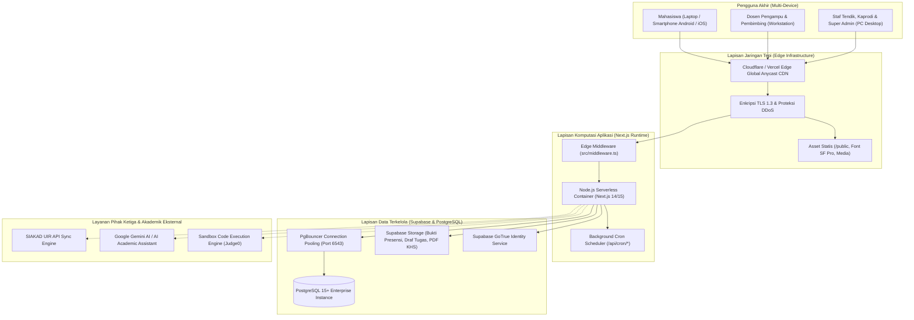
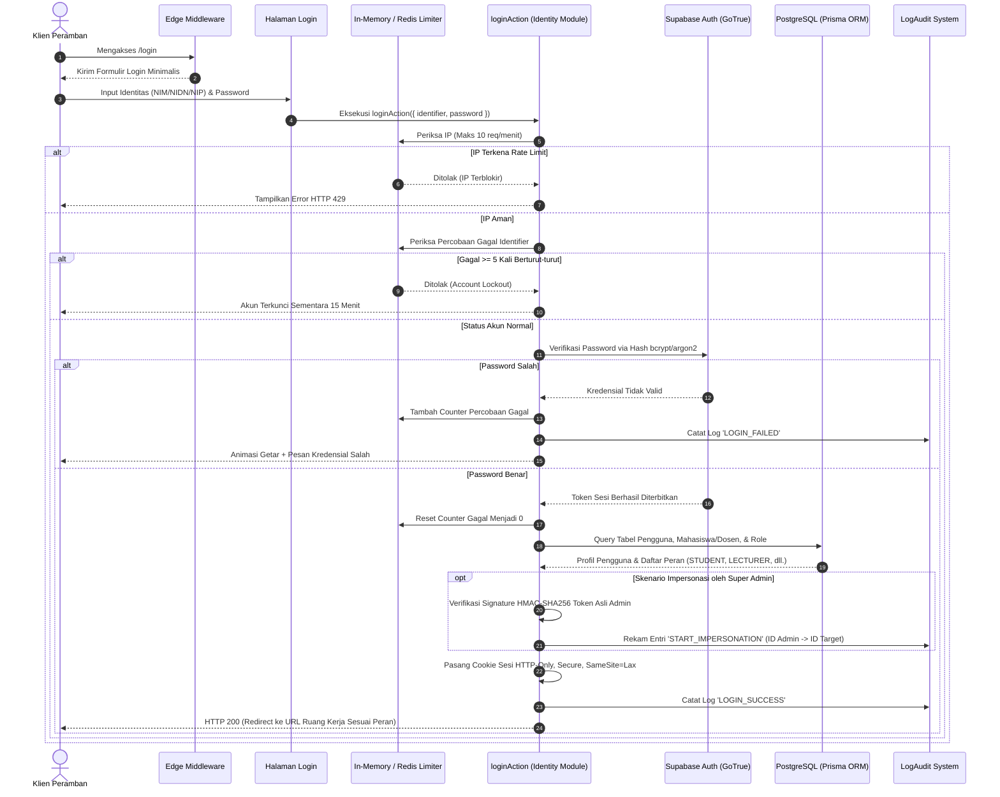
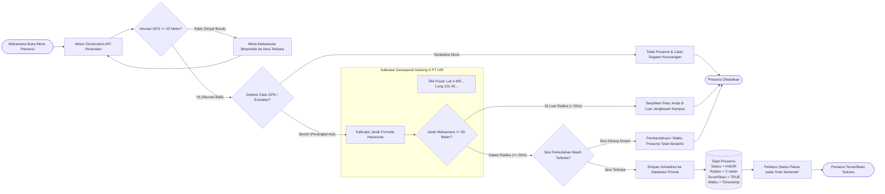
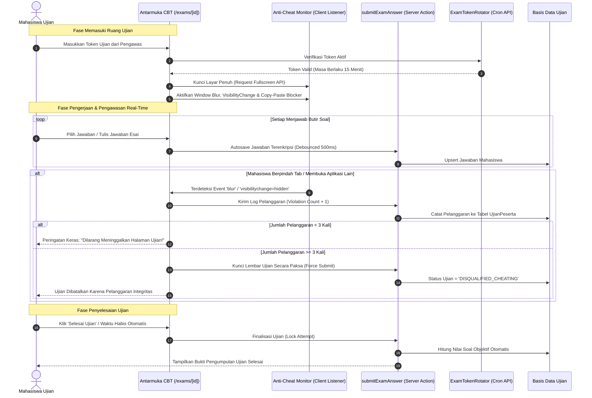
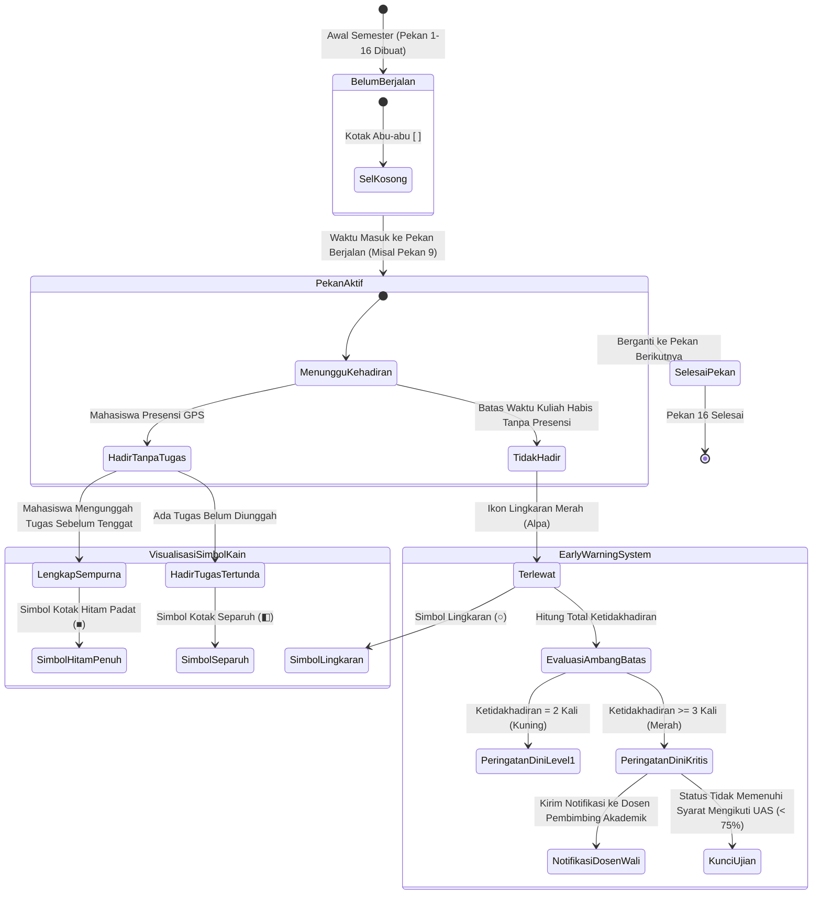
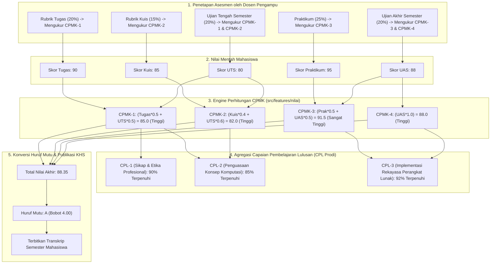
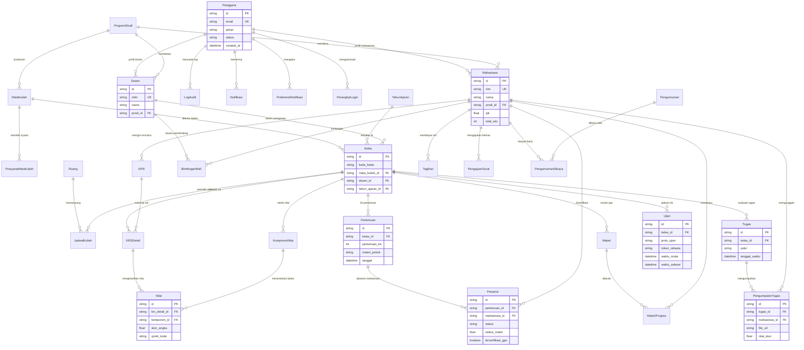

# Cetak Biru & Diagram Arsitektur Super Lengkap: RuangKampus
**Platform Pembelajaran & Manajemen Akademik Berbasis OBE**  
**Program Studi Teknik Informatika — Universitas Islam Riau**  
*Dokumen Arsitektur Komprehensif · Versi 3.0 · Oktober 2026*

---

## DAFTAR ISI DIAGRAM
1. [Bagian 1: Topologi Infrastruktur & Deployment Cloud](#bagian-1-topologi-infrastruktur--deployment-cloud)
2. [Bagian 2: Arsitektur Perangkat Lunak & Pemisahan Lapisan Domain](#bagian-2-arsitektur-perangkat-lunak--pemisahan-lapisan-domain)
3. [Bagian 3: Protokol Autentikasi Kriptografis, Rate Limiter, & Impersonasi](#bagian-3-protokol-autentikasi-kriptografis-rate-limiter--impersonasi)
4. [Bagian 4: Mesin Presensi Cerdas Geofence GPS (Kampus UIR)](#bagian-4-mesin-presensi-cerdas-geofence-gps-kampus-uir)
5. [Bagian 5: Mesin Ujian CBT Terpadu, Rotasi Token, & Anti-Curang](#bagian-5-mesin-ujian-cbt-terpadu-rotasi-token--anti-curang)
6. [Bagian 6: Mesin Visualisasi 'Kain Semester' & Sistem Peringatan Dini](#bagian-6-mesin-visualisasi-kain-semester--sistem-peringatan-dini)
7. [Bagian 7: Mesin Penilaian OBE (Perhitungan CPMK & CPL)](#bagian-7-mesin-penilaian-obe-perhitungan-cpmk--cpl)
8. [Bagian 8: Relasi Entitas Basis Data Menyeluruh (30+ Model Prisma ERD)](#bagian-8-relasi-entitas-basis-data-menyeluruh-30-model-prisma-erd)
9. [Bagian 9: Matriks Hak Akses & Otorisasi Peran (RBAC Matrix)](#bagian-9-matriks-hak-akses--otorisasi-peran-rbac-matrix)

---

## Bagian 1: Topologi Infrastruktur & Deployment Cloud

Menjelaskan arsitektur infrastruktur fisik dan komputasi awan yang mendasari RuangKampus, dari jaringan tepi (*Edge CDN*), komputasi nirserver (*Serverless Node.js*), hingga kluster basis data terkelola.

---

## Bagian 2: Arsitektur Perangkat Lunak & Pemisahan Lapisan Domain

Memperlihatkan arsitektur modular internal aplikasi dengan batas pemisahan tanggung jawab (*Separation of Concerns*) yang tegas antara UI, Domain Actions, Fitur, dan Kernel Lib.

```mermaid
flowchart TD
    subgraph UI_Layer["1. Lapisan Antarmuka & Presentasi (src/app)"]
        direction TB
        AuthRoutes["(auth) -> /login, /workspace, /reset-password"]
        PortalShellView["(portal) -> PortalShell & Sub-Portal Peran"]
        
        Sub_Student["/student (Portal Mahasiswa)"]
        Sub_Lecturer["/lecturer (Portal Dosen)"]
        Sub_TA["/ta (Portal Asisten Dosen)"]
        Sub_Coord["/coordinator (Portal Kaprodi)"]
        Sub_Staff["/staff (Portal Staf Akademik)"]
        Sub_Admin["/admin (Portal Administrator)"]
        
        GlobalErr["src/app/error.tsx (Crash Recovery)"]
        Global404["src/app/(portal)/not-found.tsx (404 Handler)"]
    end

    subgraph Shell_Components["2. Pustaka Komponen UI Terpadu (src/components)"]
        direction TB
        SharedComponents["shared/ (PortalShell, CommandCenterOS, AiAcademicAssistant)"]
        UiPrimitives["ui/ (TechBackground, Button, Card, Badge, Dialog)"]
        RetroComponents["retro/ (WindowTrafficLights, IdentityCard, Scanlines)"]
    end

    subgraph Domain_Modules["3. Modul Logika Bisnis & Server Actions (src/modules)"]
        direction TB
        ModIdentity["identity/ (loginAction, impersonate, switchRole)"]
        ModAcademic["academic/ (kainSemester, presensi, nilai, krs)"]
        ModAdmin["admin/ (masterData, systemPolicies, userRoles)"]
        ModEarlyWarning["early-warning/ (attendanceThresholdCheck)"]
        ModRequests["requests/ (suratPengantar, legalisasiIjazah)"]
    end

    subgraph Features_Layer["4. Fitur Modular Perkuliahan (src/features)"]
        direction TB
        FeatPresensi["presensi/ (GPS Geofencing, Rekap Mahasiswa)"]
        FeatNilai["nilai/ (Rubrik Penilaian, Konversi Mutu, KHS)"]
        FeatKrs["krs/ (Paket Semester, Validasi Kuota, Approval Wali)"]
        FeatMateriTugas["materi-tugas/ (Bahan Ajar, Upload Jawaban)"]
        FeatUjian["ujian/ (CBT Engine, Bank Soal, Anti-Curang)"]
    end

    subgraph Core_Kernel["5. Kernel Sistem & Utilitas Platform (src/lib)"]
        direction TB
        LibDb["db/ (Prisma Client Singleton & Seed Registry)"]
        LibAuth["auth/ (Session Management, Crypto Token Signer)"]
        LibAudit["audit/ (Audit Trail Logger Tamper-Proof)"]
        LibPdf["pdf/ (Generator Transkrip KHS, Kartu Ujian, Surat)"]
        LibAi["ai/ (Academic Assistant RAG & Prompt Template)"]
    end

    UI_Layer --> Shell_Components
    UI_Layer --> Domain_Modules
    Domain_Modules --> Features_Layer
    Features_Layer --> Core_Kernel
    Domain_Modules --> Core_Kernel

    PortalShellView --> Sub_Student
    PortalShellView --> Sub_Lecturer
    PortalShellView --> Sub_TA
    PortalShellView --> Sub_Coord
    PortalShellView --> Sub_Staff
    PortalShellView --> Sub_Admin

    UI_Layer -.-> GlobalErr
    UI_Layer -.-> Global404
```

---

## Bagian 3: Protokol Autentikasi Kriptografis, Rate Limiter, & Impersonasi

Diagram interaksi mendalam mengenai pengamanan gerbang masuk sistem terhadap serangan *brute force*, mitigasi akun terkunci, serta protokol impersonasi berbasis *Signed Token*.

---

## Bagian 4: Mesin Presensi Cerdas Geofence GPS (Kampus UIR)

Memvisualisasikan alur verifikasi posisi geospasial mahasiswa saat perkuliahan luring berlangsung, memastikan kehadiran hanya dapat dilakukan di dalam radius toleransi Gedung D Fakultas Teknik UIR.

---

## Bagian 5: Mesin Ujian CBT Terpadu, Rotasi Token, & Anti-Curang

Menjelaskan protokol pelaksanaan ujian terkomputerisasi (*Computer-Based Test*) yang menjaga integritas akademik mahasiswa dari kecurangan digital.

---

## Bagian 6: Mesin Visualisasi 'Kain Semester' & Sistem Peringatan Dini

State diagram yang mengatur siklus hidup tiap sel status pada kisi matriks akademik 16 pekan untuk seluruh mata kuliah yang diambil mahasiswa.

---

## Bagian 7: Mesin Penilaian OBE (Perhitungan CPMK & CPL)

Diagram alur yang memperlihatkan bagaimana evaluasi pembelajaran berbasis luaran dihitung dari bobot rubrik tugas, dipetakan ke CPMK, diagregasi ke CPL prodi, hingga pembentukan KHS.

---

## Bagian 8: Relasi Entitas Basis Data Menyeluruh (30+ Model Prisma ERD)

Skema relasional lengkap yang merefleksikan seluruh model entitas pada berkas `prisma/schema.prisma`.

---

## Bagian 9: Matriks Hak Akses & Otorisasi Peran (RBAC Matrix)

Tabel pemetaan hak akses fungsionalitas di seluruh portal untuk keenam peran pengguna sistem:

| Fitur / Sub-Sistem | Mahasiswa | Dosen | Asisten Dosen | Kaprodi | Staf Akademik | Super Admin |
| :--- | :---: | :---: | :---: | :---: | :---: | :---: |
| **Kain Semester (Kisi 16 Pekan)** | Baca Sendiri | Baca Kelas Binaan | Baca Kelas Asistensi | Rekap Prodi | - | Audit Semua |
| **Presensi GPS (Kirim Kehadiran)** | Buat (GPS Verify) | - | - | - | - | - |
| **Buka/Tutup Sesi Presensi** | - | Penuh | Buka Sesi Saja | Pantau | - | Penuh |
| **Penyusunan Rubrik OBE (CPMK)** | - | Penuh | Baca Saja | Verifikasi & Validasi | - | Konfigurasi |
| **Input & Perubahan Nilai Mutu** | - | Penuh (Pra-Kunci) | Draf Skor Tugas | Pengesahan KHS | Cetak Transkrip | Buka Kunci Khusus |
| **Penyelenggaraan Ujian CBT** | Kerjakan (Anti-Cheat) | Buat Bank Soal | Pantau / Monitor | Pantau Hasil | Cetak Berita Acara | Reset Token |
| **Pengajuan & Approval KRS** | Buat & Ajukan | Verifikasi Dosen Wali | - | Kuota & Evaluasi | Ekspor SIAKAD | Override Kuota |
| **Impersonasi Akun Pengguna** | - | - | - | - | - | Penuh (Signed Audit) |
| **Audit Trail & System Logs** | - | - | - | Log Prodi | Log Surat/KRS | Penuh (Tamper-Proof) |

---

### Verifikasi Kepatuhan Desain & Teknis
- **Tipografi**: Seluruh antarmuka portal wajib menggunakan font keluarga **Apple SF Pro** (`font-weight: 600` untuk teks isi, `font-weight: 800` untuk heading).
- **Palet Warna**: Seluruh warna dibatasi pada palet identitas resmi kampus (Terracotta `#C2553A`, Dark Terracotta `#853827`, Paper Ivory `#FAF8F5`, dan Charcoal Obsidian `#1C1917` / `#000000`).
- **Validasi Otomatis**: Diverifikasi oleh `scripts/cek-hex.js` dan kompilasi bebas galat TypeScript `tsc --noEmit`.
