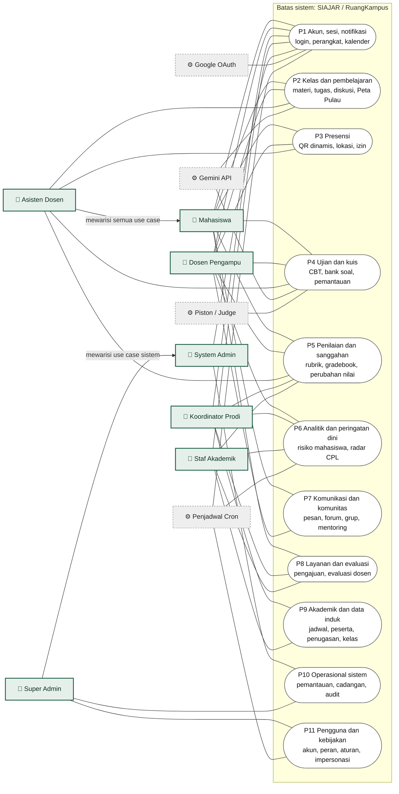
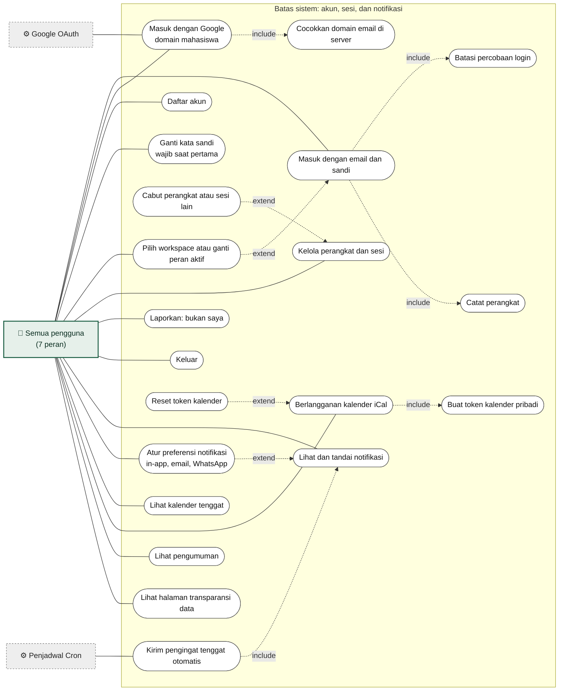
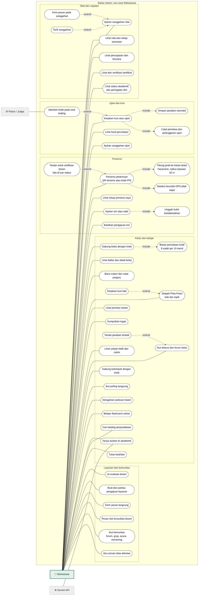
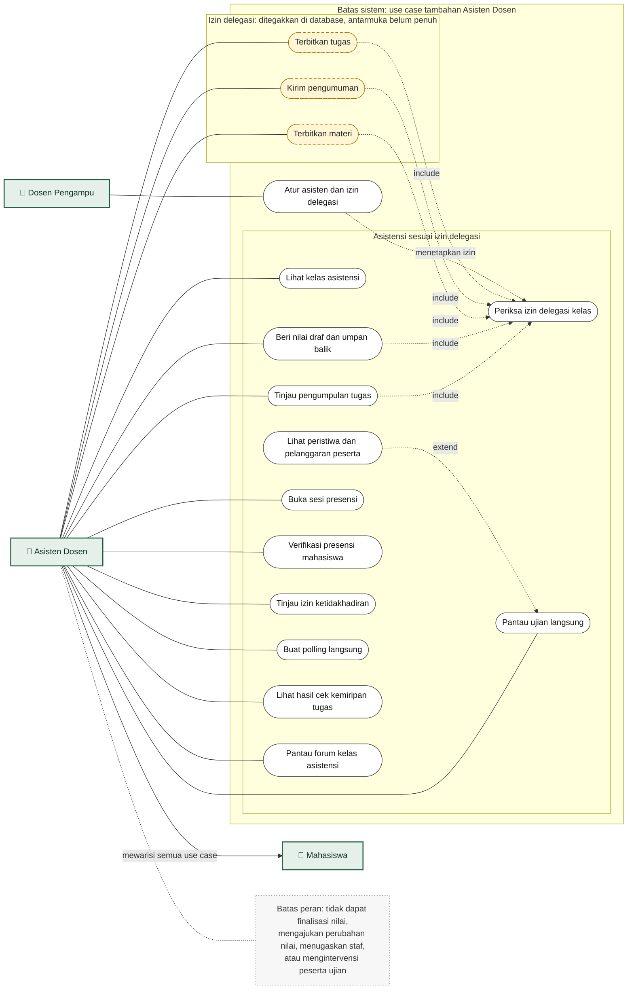
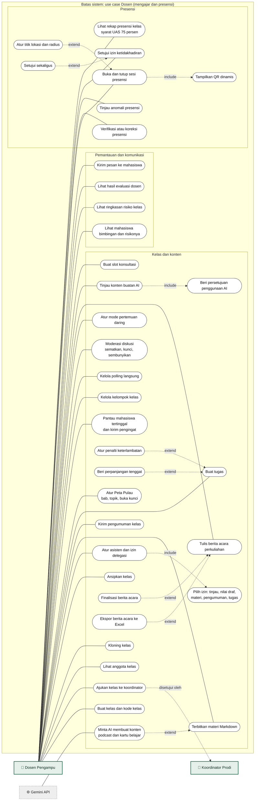
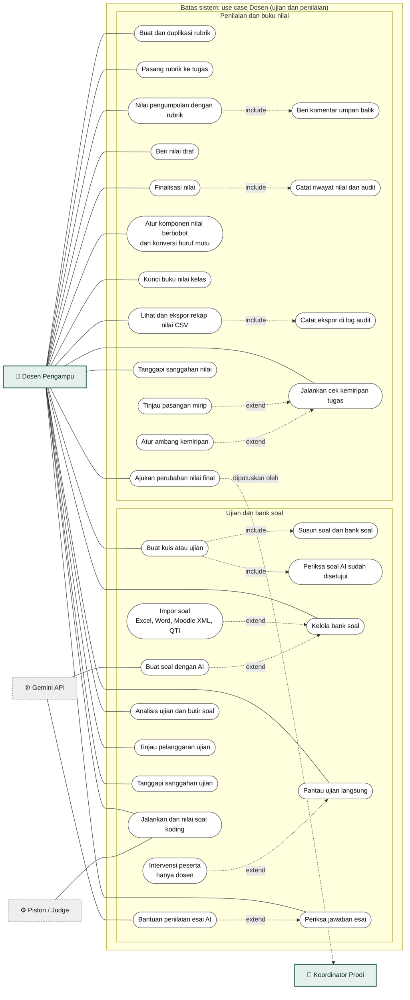
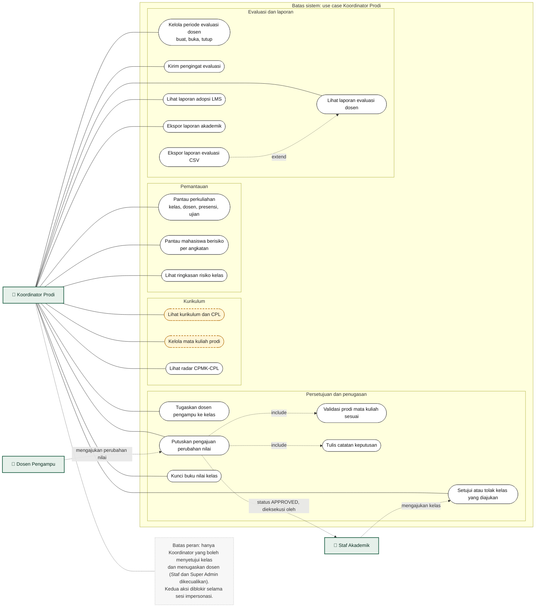
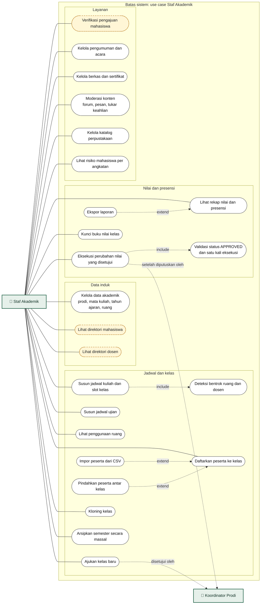
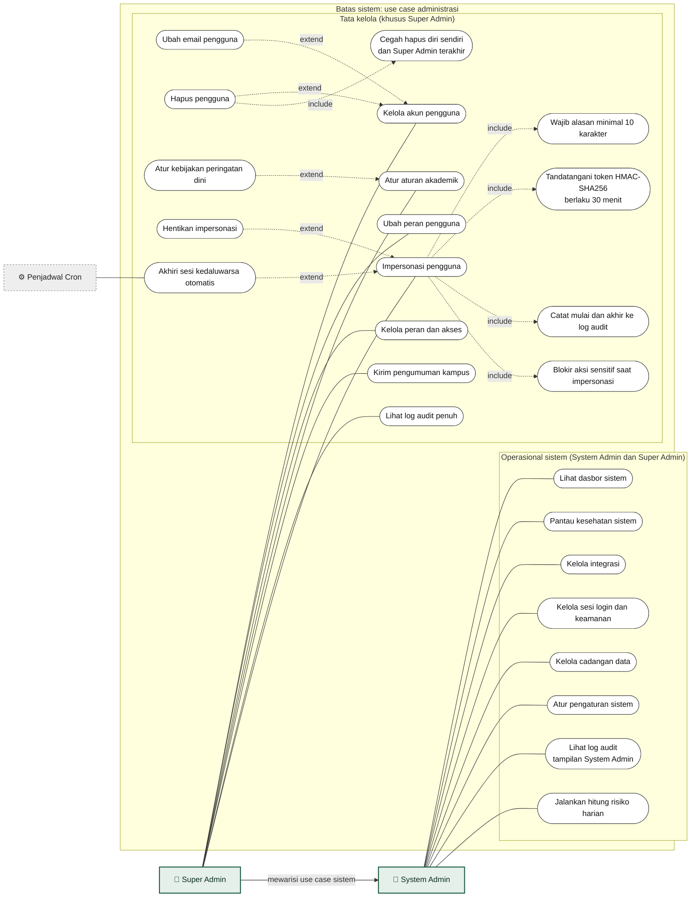
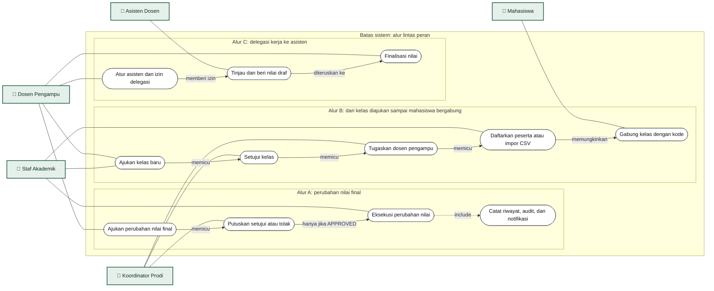

# Use Case Diagram SIAJAR / RuangKampus

Dokumen ini diturunkan langsung dari kode repo `wahyualdir/Sistem-Pembelajaran` (branch `main`): daftar menu per peran di `src/lib/config/menu-config.ts`, server actions di `src/modules/**`, dan pemeriksaan peran (guard) di dalam tiap aksi. Isinya menggambarkan **apa yang ada di kode**, bukan rencana.

## Cara membaca

| Simbol | Arti |
| --- | --- |
| Kotak `👤` | Aktor manusia (7 peran, karena kode memisahkan `SYSTEM_ADMIN` dan `SUPER_ADMIN`) |
| Kotak `⚙` abu-abu putus-putus | Aktor sekunder: sistem eksternal atau penjadwal |
| Oval | Use case |
| Oval kuning putus-putus | Ada di menu atau izin, tetapi halamannya masih cangkang atau izinnya baru ditegakkan di database (belum ada antarmuka penuh) |
| Garis polos | Asosiasi aktor dengan use case |
| Panah putus `include` | Use case dasar selalu memanggil use case yang disertakan |
| Panah putus `extend` | Use case tambahan (arah panah ke use case dasar) yang dijalankan bila kondisinya terpenuhi |
| Panah `mewarisi` | Generalisasi: aktor turunan memiliki semua use case aktor induk |

Status "terimplementasi" berarti ada server action atau halaman yang sesuai di kode. Belum diuji dengan menjalankan aplikasinya.

---

## 1. Konteks sistem (tingkat paket)

---

## 2. Use case umum (semua peran)

---

## 3. Mahasiswa

---

## 4. Asisten Dosen

Asisten adalah peran hibrida: menunya sama dengan Mahasiswa ditambah grup **Asistensi** (Kelas Asistensi, Koreksi, Pantau Ujian). Hak tambahan bergantung pada izin yang didelegasikan dosen per kelas.

---

## 5. Dosen Pengampu (bagian A: mengajar dan presensi)

---

## 6. Dosen Pengampu (bagian B: ujian dan penilaian)

---

## 7. Koordinator Program Studi

---

## 8. Staf Akademik

---

## 9. System Admin dan Super Admin

---

## 10. Use case lintas peran

Tiga alur yang melibatkan lebih dari satu aktor. Aturan pemisahan tugas (siapa yang boleh dan tidak boleh) diambil dari guard di server actions.

Aturan yang ditegakkan kode pada ketiga alur:

- **Alur A:** hanya Dosen yang boleh mengajukan perubahan nilai; hanya Koordinator dari prodi mata kuliah terkait yang boleh memutuskan; hanya Staf yang boleh mengeksekusi, dan hanya satu kali, hanya untuk status `APPROVED`.
- **Alur B:** Staf atau Dosen boleh mengajukan kelas; hanya Koordinator yang boleh menyetujui dan menugaskan dosen; hanya Staf yang boleh mendaftarkan peserta. Super Admin dikecualikan dari ketiga aksi persetujuan dan pendaftaran. Keempat aksi (mengajukan, menyetujui, menugaskan, mendaftarkan) diblokir saat sesi impersonasi.
- **Alur C:** finalisasi nilai tetap hanya milik Dosen. Asisten hanya memberi nilai draf.

---

## 11. Matriks aktor dan use case

Simbol: ✓ berwenang menurut guard di kode, ◐ sebagian atau bersyarat (lihat catatan), kosong = tidak berwenang. Kolom Asisten sudah termasuk use case yang diwarisi dari Mahasiswa.

| Use case | Mhs | Asisten | Dosen | Kaprodi | Staf | SysAdm | SuperAdm |
| --- | :-: | :-: | :-: | :-: | :-: | :-: | :-: |
| Masuk, kelola sesi dan perangkat, notifikasi | ✓ | ✓ | ✓ | ✓ | ✓ | ✓ | ✓ |
| Lihat kalender | ✓ | ✓ | ✓ | ✓ | ✓ | | |
| Gabung kelas dengan kode | ✓ | ✓ | | | | | |
| Buat kelas | | | ✓ | | | | |
| Ajukan kelas baru | | | ✓ | | ✓ | | |
| Setujui kelas dan tugaskan dosen | | | | ✓ | | | |
| Daftarkan peserta ke kelas | | | | | ✓ | | |
| Kloning kelas | | | ✓ | | ✓ | | ✓ |
| Terbitkan materi dan buat tugas | | ◐ ¹ | ✓ | | | | |
| Kirim pengumuman kelas | | ◐ ¹ | ✓ | | | | |
| Kumpulkan tugas | ✓ | ✓ | | | | | |
| Tinjau pengumpulan dan beri nilai draf | | ◐ ¹ | ✓ | | | | |
| Finalisasi nilai | | | ✓ | | | | |
| Ajukan perubahan nilai final | | | ✓ | | | | |
| Putuskan perubahan nilai final | | | | ✓ | | | |
| Eksekusi perubahan nilai yang disetujui | | | | | ✓ | | |
| Kunci buku nilai kelas | | | ✓ | ✓ | ✓ | | |
| Atur asisten dan izin delegasi | | | ✓ | | | | ✓ |
| Presensi sebagai peserta | ✓ | ✓ | | | | | |
| Buka sesi presensi | | ◐ ¹ | ✓ | | | ✓ ² | ✓ ² |
| Verifikasi presensi | | ✓ | ✓ | | | | ✓ |
| Setujui izin ketidakhadiran | | ✓ | ✓ | | | | |
| Buat kuis atau ujian | | | ✓ | | | | ✓ |
| Kerjakan kuis atau ujian | ✓ | ✓ | | | | | |
| Pantau ujian langsung | | ✓ | ✓ | ✓ | ✓ | | ✓ |
| Intervensi peserta ujian | | | ✓ | | | | |
| Buat polling langsung | | ✓ | ✓ | | | | ✓ |
| Jalankan cek kemiripan tugas | | ✓ | ✓ | | | | ✓ |
| Isi evaluasi dosen | ✓ | ✓ | | | | | |
| Kelola periode evaluasi dosen | | | | ✓ | | | ✓ |
| Buat pengajuan layanan | ✓ | ✓ | | | | | |
| Proses pengajuan layanan | | | | | ✓ | | ✓ |
| Pantau risiko mahasiswa per angkatan | | | | ✓ | ✓ | | |
| Lihat mahasiswa bimbingan dan risiko kelas | | | ✓ | | | | |
| Kelola katalog perpustakaan | | | ✓ | ✓ | ✓ | | |
| Tanya asisten AI akademik | ✓ | ✓ | | | | | |
| Atur kebijakan peringatan dini | | | | | | | ✓ |
| Hitung risiko harian | | | | | | ✓ | ✓ |
| Lihat log audit | | | | | | ◐ ³ | ✓ |
| Pemantauan, integrasi, sesi login, cadangan, pengaturan sistem | | | | | | ✓ | ✓ |
| Kelola akun, peran, dan hapus pengguna | | | | | | | ✓ |
| Impersonasi pengguna | | | | | | | ✓ |

Catatan:

1. Izin Asisten didelegasikan dosen per kelas. Lima izin yang bisa didelegasikan: tinjau pengumpulan, nilai draf, kelola materi, kelola pengumuman, buat tugas. Penegakannya ada di database. Antarmuka asisten baru mencakup peninjauan pengumpulan dan nilai draf (README bagian "Batasan yang diketahui"). Finalisasi nilai, perubahan nilai, dan penugasan staf sengaja tidak bisa didelegasikan.
2. Guard `createAttendanceSessionAction` mengizinkan SYSTEM_ADMIN dan SUPER_ADMIN, tetapi tidak ada menu terkait untuk kedua peran itu.
3. System Admin membaca tampilan `audit_logs_for_sysadmin`, bukan tabel audit penuh.

---

## 12. Selisih dengan dokumen `ARSITEKTUR_PER_ROLE.md`

Hasil membandingkan dokumen buatan Antigravity dengan kode. Gunakan kolom kanan bila dokumen itu dipakai untuk laporan.

| Klaim di dokumen | Yang ditemukan di kode |
| --- | --- |
| Enam peran | Tujuh kode peran. `SYSTEM_ADMIN` (8 menu) dan `SUPER_ADMIN` (12 menu) terpisah |
| Token impersonasi berlaku 15 menit | 30 menit; wajib alasan minimal 10 karakter; bila pencatatan audit gagal, aksi dibatalkan |
| Presensi geofence ke titik Gedung D, ≤ 50 m | Jarak Haversine ke koordinat yang tersimpan pada sesi presensi (diisi dosen), radius bawaan 50 m. Bila koordinat tidak diisi, kode memakai bawaan -6.2088, 106.8456 (area Jakarta), bukan kampus UIR. Di luar radius tidak ditolak otomatis, tetapi ditandai agar diverifikasi dosen. Metodenya QR dinamis atau kode PIN |
| Anti-mock location | Heuristik: akurasi GPS di bawah 1 m atau di atas 500 m, dan lompatan kecepatan tidak wajar |
| Asisten dapat mengirim teguran saat ujian | Intervensi ujian hanya untuk Dosen. Asisten hanya memantau |
| Audit log tamper-proof | Append-only lewat trigger, dengan pengecualian terkontrol (`lawful_retention_purge`, `lawful_anonymization`). Belum ada hash chain |
| Pemantauan ujian streaming real-time | Polling setiap 5 detik |
| Dokumen PDF bertanda tangan digital | Hanya kotak tanda tangan pada tata letak; tidak ada tanda tangan kriptografis atau QR verifikasi |
| Kaprodi mengesahkan KHS | Kaprodi memutuskan perubahan nilai; yang mengeksekusi perubahan adalah Staf |
| Menu Kurikulum, Mata Kuliah (Kaprodi) serta Mahasiswa, Dosen, Pengajuan Masuk (Staf) disebut sebagai bagian arsitektur | Menunya ada, tetapi halamannya cangkang berisi ringkasan dan tautan; fungsinya ada di hub lain (ditandai kuning di diagram) |

---

## Menyimpan di repo

Simpan sebagai `docs/USE_CASE_SIAJAR.md`. GitHub dan pratinjau markdown Antigravity merender blok `mermaid` langsung. Bila pratinjau menampilkan error pada satu blok, laporkan nomor diagramnya.
